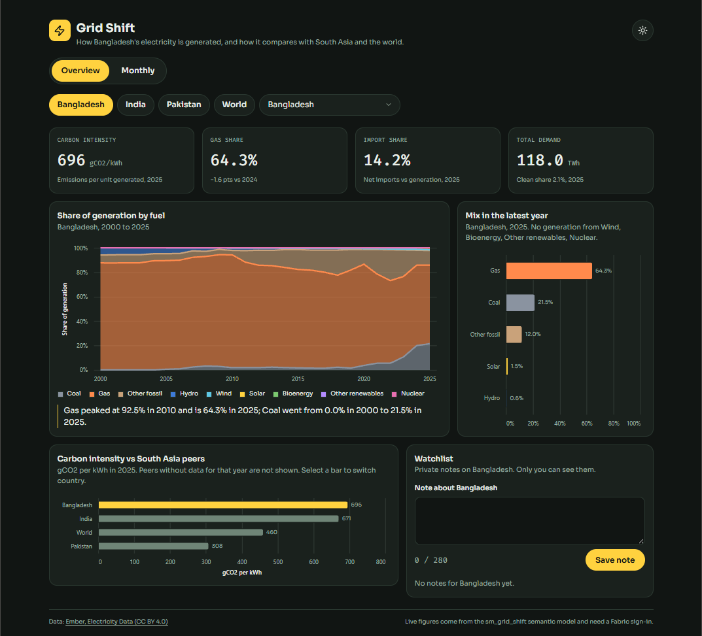
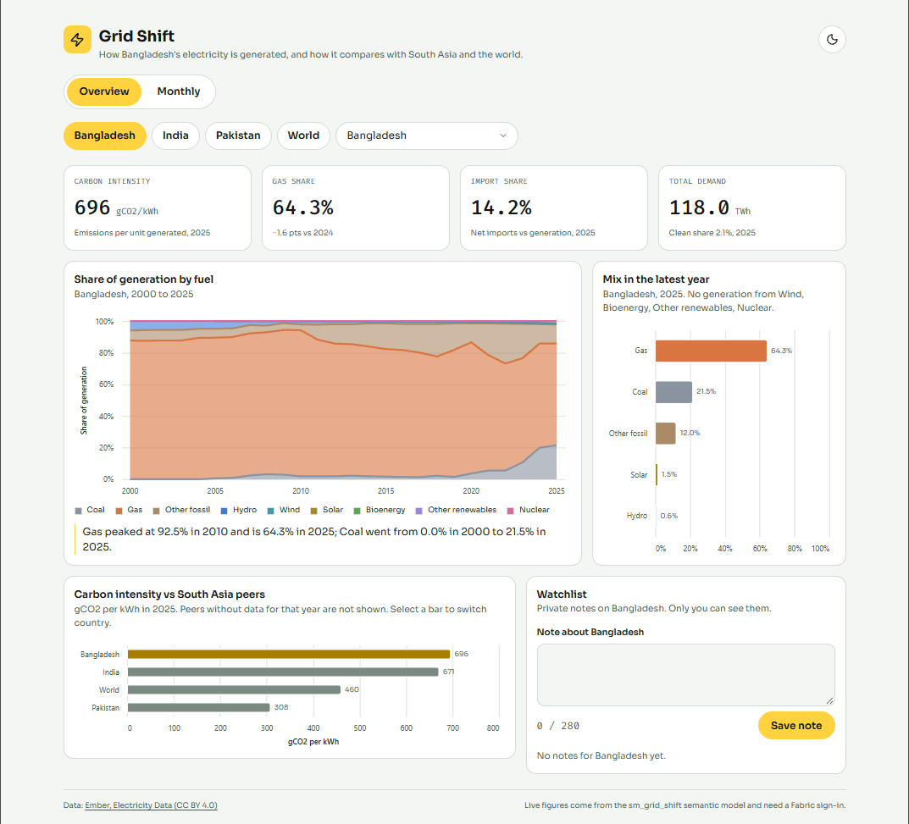
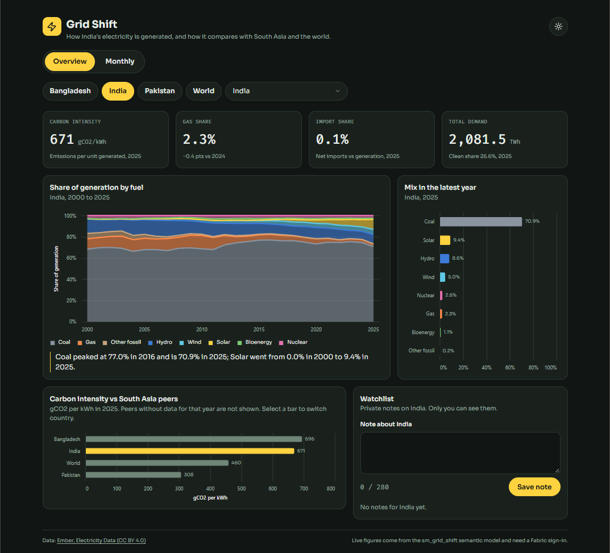
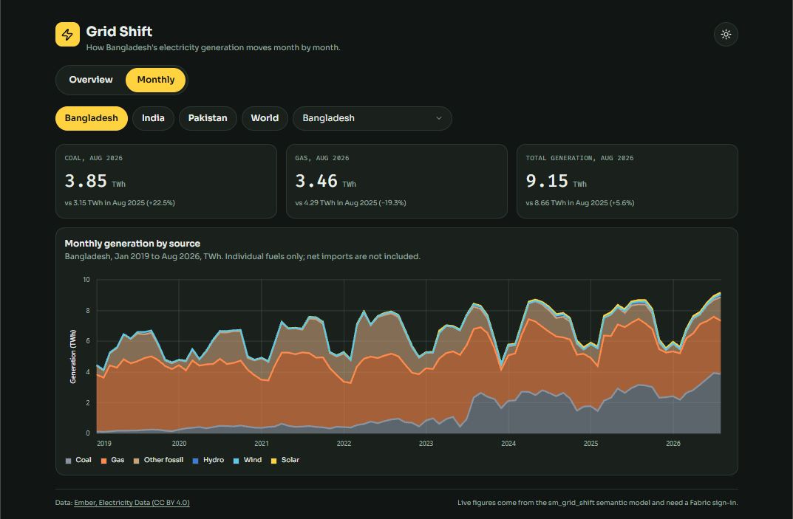
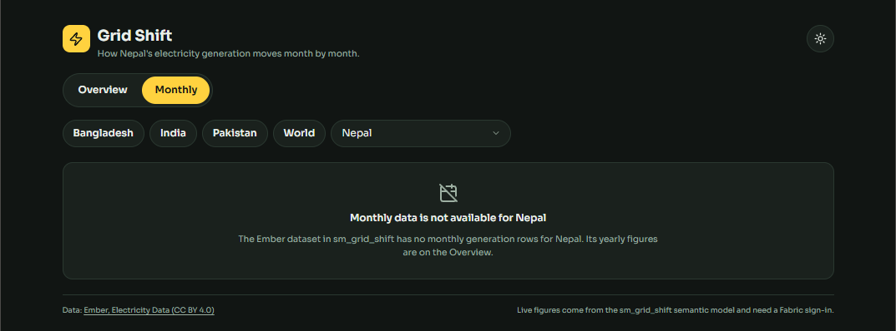
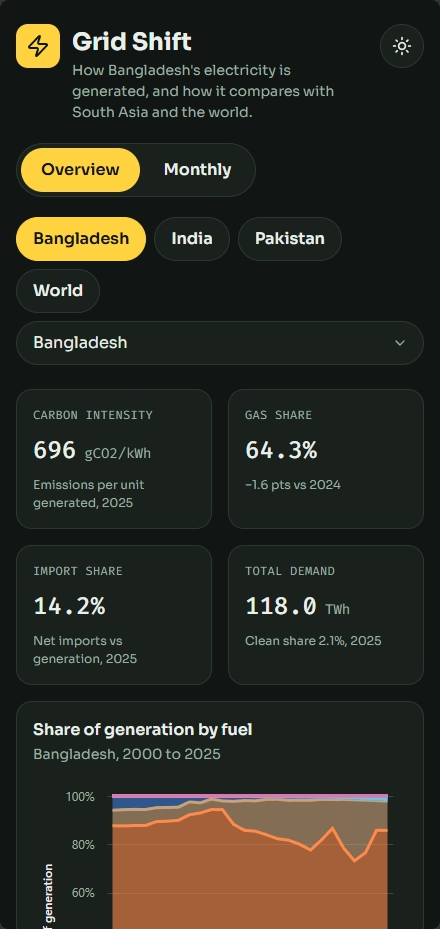
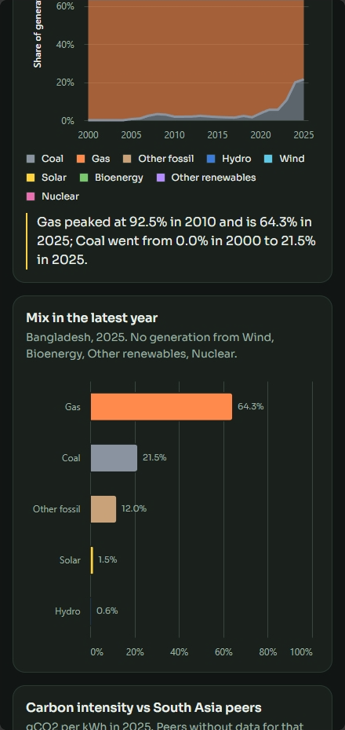
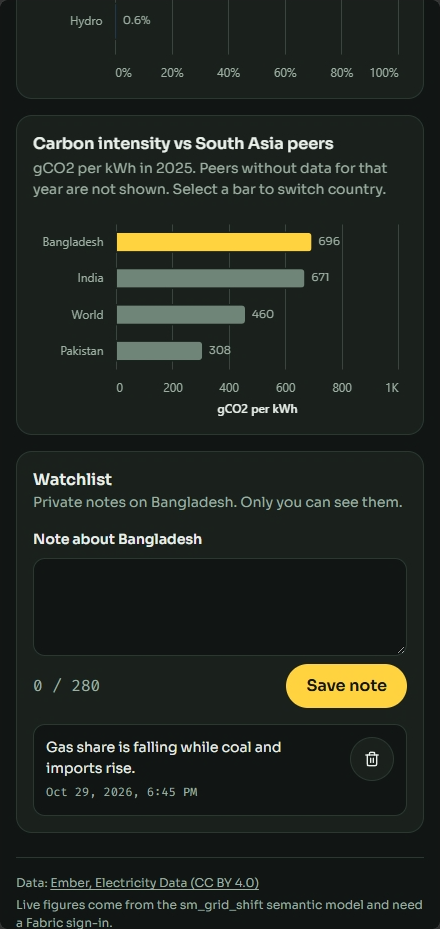
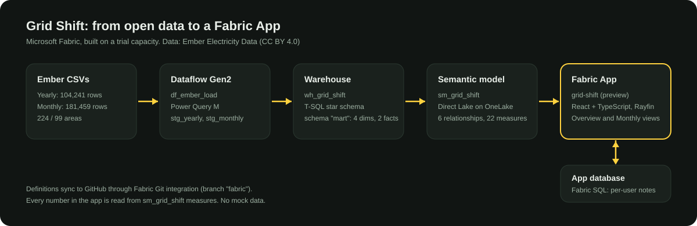

# Grid Shift

**How Bangladesh's electricity is generated, and how it compares with South Asia and the world.**

A Microsoft Fabric project end to end: a Dataflow Gen2 loads Ember's open electricity data into a Fabric Warehouse, a star schema and a Direct Lake semantic model sit on top, and a Fabric App (preview) presents it.



<!-- TODO: add the demo recording link (60-90 s) here before publishing: [Watch the demo](<link>) -->

<details>
<summary>More screenshots</summary>

| | |
|---|---|
|  |  |
|  |  |

Phone width:

  

</details>

## What the data says

Figures below come from the semantic model and were reconciled against Ember's raw CSV.

| Bangladesh, 2025 | Value |
|---|---|
| Gas share of generation | 64.3% (92.5% peak in 2010) |
| Coal share | 21.5% (about 0% in 2000) |
| Net imports vs generation | 14.2% |
| Clean share | 2.1% |
| Carbon intensity | 696 gCO2e/kWh |
| Total demand | 118.0 TWh |

The story is not a solar boom. Gas is losing share, mainly to coal and imports, and clean power is still about 2%.

## Architecture



```
Ember CSVs (yearly + monthly, CC BY 4.0)
  -> Dataflow Gen2 (df_ember_load): staging tables stg_yearly, stg_monthly
  -> Fabric Warehouse (wh_grid_shift): star schema in schema "mart" built with T-SQL CTAS
  -> Semantic model (sm_grid_shift): Direct Lake on OneLake, 6 relationships, 22 DAX measures
  -> Fabric App "grid-shift" (Rayfin SDK, preview): React + TypeScript, delegated sign-in
       + app database (Fabric SQL) for per-user watchlist notes
```

- **Sources:** Ember yearly generation (104,241 rows, 224 areas, 2000-2025) and monthly generation (181,459 rows, 99 areas, Jan 2019 to Aug 2026).
- **Warehouse:** `mart.dim_source`, `dim_area`, `dim_year`, `dim_date`, `fact_generation_yearly`, `fact_generation_monthly`. Row counts and duplicate checks are in [`warehouse/01_mart_schema.sql`](warehouse/01_mart_schema.sql).
- **Semantic model:** edited as TMDL through Fabric Git integration (the `fabric` branch). Summary sources (Clean, Fossil, Total, ...) are never summed with individual fuels.
- **App:** every number comes from sm_grid_shift measures through the semantic model connector. No mock data. Overview and Monthly views, light and dark themes, phone layout, 44px touch targets.
- **Watchlist:** a small notes feature backed by the app's own SQL database, to show the app can write as well as read. Notes are per user.

## Things worth knowing

- **How it was built.** With AI assistance. Claude drafted the SQL and Power Query, and Claude Code wrote the app code and DAX measures. I chose the dataset and the story, decided the architecture and the warehouse model, ran every step in Fabric, validated the results against Ember's raw data, and tested the per-user notes with two accounts.
- **Pattern.** Built with the Fabric Apps `dataapp` template and a semantic-model connector, following Microsoft's documented pattern: [Create an app connected to a semantic model](https://learn.microsoft.com/en-us/fabric/apps/data-apps-template) and [Connect Fabric Apps to Fabric data](https://learn.microsoft.com/en-us/fabric/apps/connectors). Per-user notes follow the documented `@role` policy pattern ([Define data models](https://learn.microsoft.com/en-us/fabric/apps/data-models)). Three details I needed were not in the docs pages I read: Direct Lake as the model's storage mode, the database `dialect: mssql` setting, and the `devUri` local dev flow.
- **Preview and sign-in.** Fabric Apps are in preview and the live app needs a Fabric sign-in with access to the workspace. It ran on a Fabric trial capacity that ends in early November 2026, so the recording and screenshots above are the lasting record.
- **Verification.** Bangladesh 2025 values were reconciled between a DAX query and the raw CSV, and a monthly comparison (Bangladesh coal, Aug 2026 vs Aug 2025) was checked against the CSV.
- **Notes privacy.** Each user sees and deletes only their own notes. Tested with two accounts in separate private browser sessions; checked in the database that each note carries its author's owner ID. The app keeps its sign-in cached per browser, so test several accounts in separate private windows. The Rayfin documentation lists only `sub`, `email` and `role` as claims for data-API rules.
- **Data limits.** Ember's latest months are provisional and get revised. Pakistan's monthly series ends earlier than the others, and Nepal has yearly data only (the Monthly view says so).

## Repository layout

| Path | What |
|---|---|
| `warehouse/` | T-SQL for the mart star schema and the source colour mapping |
| `app/grid-shift/` | The Fabric App (Rayfin dataapp). `rayfin/rayfin.yml.example` shows the config; the real file holds workspace IDs and is git-ignored |
| `docs/` | Brief, design spec and schedule |
| `fabric` branch | Dataflow and semantic model definitions synced by Fabric Git integration |

## Data and licence

Data: [Ember, Electricity Data](https://ember-energy.org/data/electricity-data-explorer/) (CC BY 4.0).

Code in this repository is released under the [MIT License](LICENSE). The scaffold in `app/grid-shift` keeps its own LICENSE file.

Built by Siam Sadman, Dhaka. Portfolio: siamsadman.vercel.app
